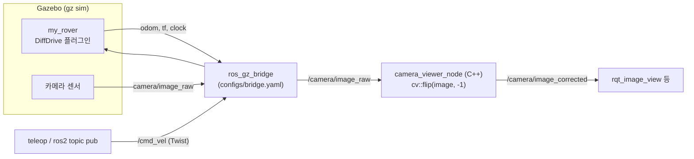

# 🤖 ROS 2 Rover Simulation (URDF/Xacro + Gazebo)


URDF/Xacro로 카메라가 달린 3륜(구동 2 + 캐스터 1) 차동구동 로버를 모델링하고, Gazebo(gz sim)에 띄워 ROS 2와 연결한 과제입니다.
Gazebo 카메라 영상을 받아 180° 회전 보정한 뒤 다시 발행하는 C++ 노드를 함께 작성했습니다. 이 로버는 이후 카메라 라인트레이싱 실험의 시뮬레이션 기반으로 사용했습니다.

| 항목 | 내용 |
|---|---|
| 플랫폼 | ROS 2 Humble · Gazebo Harmonic (gz sim) · ros_gz_bridge |
| 언어 | C++ (노드) · Python (launch) · URDF/Xacro |
| 라이브러리 | rclcpp · cv_bridge · OpenCV |
| 패키지 이름 | `simulation` |

---

## 로봇 모델 ([`urdf/my_rover.urdf.xacro`](urdf/my_rover.urdf.xacro))

```
base_link (몸체 1.0 × 0.5 × 0.3 m, 흰색, 마찰 0.2)
├── left_wheel  / right_wheel  (반지름 0.3 m, 폭 0.25 m, 빨간색, 마찰 0.84)  ← continuous joint
├── caster_wheel               (구, 반지름 0.2 m, 검은색)
└── camera_link                (몸체 앞면 위쪽 중앙, roll 180° → 영상이 뒤집혀 나옴)
```

- 모든 치수는 `xacro:property`로 정의해 값 하나만 바꿔 모델을 수정할 수 있습니다.
- 카메라 센서는 [`camera.urdf.xacro`](urdf/camera.urdf.xacro)의 매크로(`normal_camera`)로 분리했습니다. 30Hz, 토픽 `camera/image_raw`.

### Gazebo 플러그인 설정

| 플러그인 | 주요 값 |
|---|---|
| `gz-sim-diff-drive-system` | 바퀴 간격 `wheel_separation + wheel_width` = 0.32 m, 바퀴 반지름 0.3 m, 최대 토크 20 Nm, `max_wheel_acceleration` 1.0, 오도메트리 30Hz, 입력 `cmd_vel` / 출력 `odom` |
| 카메라 센서 | 30Hz, `camera/image_raw` + `camera/camera_info` (해상도는 지정하지 않아 Gazebo 기본값) |

## 시스템 구조



- 브리지는 `clock`, `joint_states`, `odom`, `tf`, `imu`, `camera/image_raw`, `camera/camera_info`(Gazebo→ROS)와 `cmd_vel`(ROS→Gazebo)을 연결합니다. (`imu`, `joint_states`는 해당 플러그인이 URDF에 없어 실제로는 데이터가 나오지 않습니다.)
- `camera_viewer_node`는 화면 출력 없이 `/camera/image_raw`를 받아 상하좌우 반전(180° 회전)한 영상을 `/camera/image_corrected`로 발행합니다.

## 파일 구조

```
ros2-rover-simulation/        (패키지 이름: simulation)
├── CMakeLists.txt
├── package.xml
├── urdf/
│   ├── my_rover.urdf.xacro   # 로버 본체·바퀴·DiffDrive 플러그인
│   └── camera.urdf.xacro     # 카메라 센서 매크로
├── launch/
│   └── simulation.launch.py  # Gazebo + 로봇 스폰 + 브리지 + camera_viewer
├── src/
│   └── camera_viewer.cpp     # 180° 영상 보정 노드
├── worlds/
│   └── default.sdf           # 지면 + 조명만 있는 기본 월드
├── configs/
│   ├── bridge.yaml           # ROS ↔ Gazebo 토픽 매핑
│   └── server.config         # Gazebo 서버 플러그인 설정
└── .pre-commit-config.yaml
```

## 설치 및 빌드

```bash
# ROS 2 Humble + Gazebo Harmonic 연동 패키지
# (플러그인 이름이 gz-sim-* 형식이라 Gazebo Garden 이후 버전이 필요합니다)
sudo apt install ros-humble-desktop ros-humble-ros-gzharmonic ros-humble-cv-bridge ros-humble-xacro

# 워크스페이스에 클론 (패키지 이름에 맞춰 폴더명을 simulation으로)
mkdir -p ~/simulation_ws/src && cd ~/simulation_ws/src
git clone https://github.com/bananabus6907/ros2-rover-simulation.git simulation

cd ~/simulation_ws
colcon build --symlink-install
source install/setup.bash
```

## 실행

```bash
# GUI 포함
ros2 launch simulation simulation.launch.py

# GUI 없이 (서버만)
ros2 launch simulation simulation.launch.py gui:=false

# 다른 월드 파일
ros2 launch simulation simulation.launch.py worldfile:=/path/to/world.sdf
```

로봇 조종과 영상 확인:
```bash
ros2 run teleop_twist_keyboard teleop_twist_keyboard                         # 키보드 조종
ros2 topic pub /cmd_vel geometry_msgs/Twist "{linear: {x: 0.5}, angular: {z: 0.0}}"   # 전진
ros2 run rqt_image_view rqt_image_view                                       # /camera/image_corrected 선택
```

## ROS 2 토픽

| 토픽 | 타입 | 방향 |
|---|---|---|
| `/cmd_vel` | `geometry_msgs/Twist` | 입력 (ROS → Gazebo) |
| `/odom` | `nav_msgs/Odometry` | 출력 (30Hz) |
| `/tf` | `tf2_msgs/TFMessage` | 출력 |
| `/camera/image_raw` | `sensor_msgs/Image` | 원본 영상 (뒤집힘) |
| `/camera/image_corrected` | `sensor_msgs/Image` | 180° 보정 영상 |

## 문제 해결

```bash
# 로봇이 스폰되지 않을 때: 남아 있는 Gazebo 프로세스 정리 후 재실행
pkill -9 -f "gz sim"; ros2 launch simulation simulation.launch.py

# 카메라 토픽이 안 보일 때: 브리지 확인
ros2 topic list | grep camera
ros2 run ros_gz_bridge parameter_bridge /camera/image_raw@sensor_msgs/msg/Image[gz.msgs.Image

# URDF 문법 확인
xacro urdf/my_rover.urdf.xacro > /tmp/robot.urdf && check_urdf /tmp/robot.urdf
```

## 배운 점
- **URDF/Xacro**: property·macro로 파라미터화된 로봇 모델, link·joint 관계, 센서 장착 자세(rpy) 설정
- **ROS 2 ↔ Gazebo 연동**: `ros_gz_sim create`로 스폰, `ros_gz_bridge` YAML로 토픽 타입 매핑, launch 인자(GUI on/off, 월드 파일)
- **영상 처리 노드**: cv_bridge로 ROS 이미지 ↔ OpenCV 변환, C++ rclcpp 노드 작성

## 개선할 점
- DiffDrive 플러그인에 넣은 바퀴 간격(0.32 m)과 URDF의 실제 바퀴 조인트 위치(좌우 ±0.375 m)가 달라, 회전할 때 오도메트리가 실제 움직임과 어긋날 수 있습니다. 두 값을 같은 property에서 계산하도록 맞추는 것이 좋습니다.
- `package.xml`의 description·maintainer가 참고한 튜토리얼 값 그대로라 수정이 필요합니다.

---

### 관련 저장소
- [ros2_ws](https://github.com/bananabus6907/ros2_ws) — 같은 과목의 TurtleBot3 + Jetson Nano 실물 라인트레이싱
- [docker-ros2-environment](https://github.com/bananabus6907/docker-ros2-environment) — ROS 2 Humble Docker 개발 환경

작성자: 2021042014 이승준
